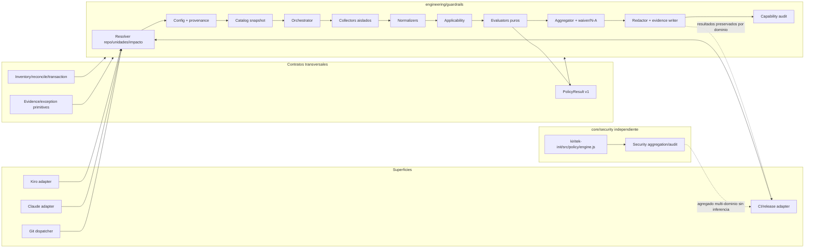
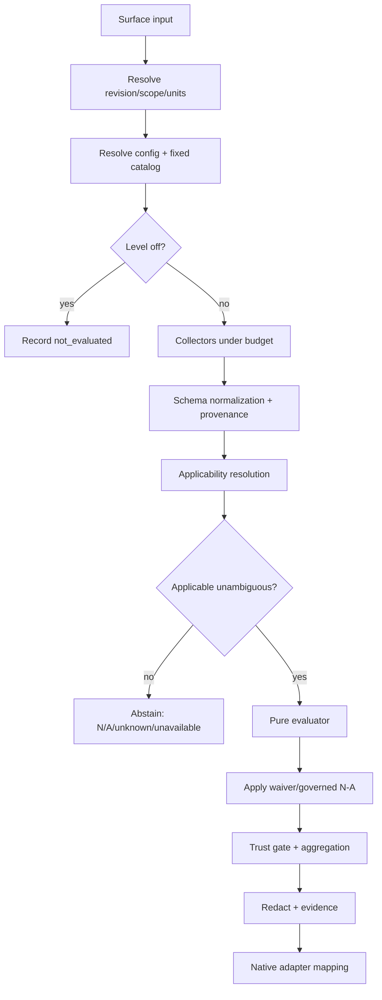

# Diseño técnico — Kiritek Engineering Guardrails

## 1. Objetivos, no objetivos y criterio de terminado

### 1.1 Objetivos

Este diseño implementa el pack independiente `engineering/guardrails` para detectar omisiones funcionales verificables en unidades `web`, `mobile-app`, `search`, `module-launch` y perfiles extensibles. Debe:

1. reutilizar contratos transversales maduros de `kiritek-init` sin acoplar niveles ni resultados agregados a `core/security`;
2. resolver catálogo, perfiles, unidades, configuración y procedencia de forma reproducible;
3. ejecutar un pipeline único `collector → normalizer → applicability → evaluator → aggregator → adapter` en agent, pre-commit, PR y release;
4. limitar toda heurística a `warn` y permitir `deny` únicamente con evidencia determinista, vigente, atribuible y aplicable;
5. soportar monorepos, cache seguro, evidencia redactada, waivers, N/A gobernado, plugins y lifecycle transaccional;
6. ofrecer CLI/JSON provider-neutral, auditoría de capacidades reales y promoción gradual por unidad/control.

El diseño se considera implementado cuando la suite de conformidad demuestra R27.1–R27.7, los tres controles iniciales pasan sus matrices contractuales y ninguna ruta heurística, parcial, stale, conflictiva, no aplicable o indisponible puede producir `deny`.

### 1.2 No objetivos

- No reemplazar discovery, UX review, QA exploratorio, arquitectura ni aprobación de producto.
- No inferir intención de negocio desde nombres, prompts, tickets, branches, rutas o dependencias.
- No imponer framework, librería, store, transporte, sistema de anuncios o test runner.
- No medir rendimiento real de producción con análisis estático.
- No administrar App Store/Play Store, feature flags, analytics o infraestructura remota.
- No definir seguridad, secretos, IAM o protección de ramas; eso permanece en `core/security`.
- No prometer inviolabilidad de hooks locales; PR/release son la protección compartida.
- No incorporar reglas engineering en `kiritek-init/src/policy/engine.js`, que seguirá especializado en `files.sensitive` del dominio security.

## 2. Decisiones y principios normativos

1. **Dos dominios, contratos transversales comunes.** `core/security` y `engineering/guardrails` poseen config, catálogo, niveles, promoción, auditoría, inventario lógico y agregación independientes.
2. **Envelope v2, payload compatible v1.** Se conserva el `PolicyResult` validado por `kiritek-init/src/domain/result.js`; el contexto engineering se añade en un envelope versionado para no romper `schemas/result.schema.json` (`additionalProperties: false`).
3. **Perfiles son declaraciones, no detecciones.** El discovery sólo genera sugerencias no autoritativas.
4. **Aplicabilidad precede a decisión.** `not_applicable`, `unknown`, `unavailable` y `off` nunca significan conformidad.
5. **Collectors no importan decisiones.** Observan; normalizers validan; evaluators puros deciden con fixtures.
6. **Deny es una capacidad, no una severidad.** Requiere nivel `enforce`, contrato enforcement aprobado y evidencia determinista apta.
7. **Feedback temprano, gate tardío.** Agent/pre-commit son rápidos y locales; PR/release admiten tests y artefactos más costosos.
8. **Catálogo fijado por ejecución.** No existe fallback silencioso a `latest`.
9. **Privacidad antes de persistencia.** Toda salida cruza redacción y validación; fallo de redacción impide publicación.
10. **Adopción reversible.** Instalar, actualizar, migrar, promover, degradar y desinstalar preservan estado y personalizaciones.

## 3. Arquitectura y límites



### 3.1 Límite `core/security` / `engineering/guardrails`

| Responsabilidad | `core/security` | `engineering/guardrails` | Compartido |
|---|---|---|---|
| Reglas | secretos, Git, Jira y controles security | prácticas de ingeniería/producto | ninguna regla concreta |
| Config | `kiritek-security.config.json`; `warning|enforce` | `kiritek-engineering.config.json`; `off|warn|enforce` por control | loader/schema utilities |
| Motor | `src/policy/engine.js` | `src/engineering/guardrails/orchestrator.js` + evaluators | `domain/result.js` |
| Catálogo | no requerido por este pack | snapshot versionado obligatorio | semver/hash/signature utilities |
| Auditoría/promoción | security-only | engineering por unidad/control | renderer/envelope |
| Instalación | owner `core/security` | owner `engineering/guardrails` | inventory/reconcile/transaction |
| Agregación | resultados security | resultados engineering | reporte multidominio que no cruza significado |

El agregador multidominio conserva cada resultado. Un `allow` engineering no prueba seguridad y viceversa. Pack ausente se registra `not-installed`, no `failed`, en la auditoría del otro.

### 3.2 Límites de confianza

- Workspace, config de repo, manifests, tests y output de plugins son no confiables; nunca se evalúan como shell.
- Procesos se ejecutan con `spawn(file, args, {shell:false})`, cwd confinado y environment allowlisted.
- Config organizacional sólo participa si firma, origen y versión satisfacen trust policy local.
- Forks no reciben secretos privilegiados ni collectors remotos.
- Evidencia manual declara explícitamente actor humano; nunca se etiqueta automatizada.
- Cache no es confianza: cada entrada se revalida por identidad y checksum.

## 4. Árbol de módulos propuesto

```text
kiritek-init/
├── src/
│   ├── engineering/
│   │   └── guardrails/
│   │       ├── index.js
│   │       ├── cli.js
│   │       ├── orchestrator.js
│   │       ├── contracts/{profile,unit,catalog,control,observation,evidence,applicability,practice-input,result-envelope}.js
│   │       ├── catalog/{load,resolve,verify,diff,migrate,registry}.js
│   │       ├── config/{defaults,load,precedence,provenance,validate}.js
│   │       ├── workspace/{discover,units,identity,ownership,impact-graph,scope}.js
│   │       ├── pipeline/{collect,normalize,applicability,evaluate,aggregate,exceptions}.js
│   │       ├── controls/
│   │       │   ├── search-input-rate/{collector,normalizer,applicability,evaluator}.js
│   │       │   ├── app-minimum-supported-version/{collector,normalizer,applicability,evaluator}.js
│   │       │   └── web-module-announcement/{collector,normalizer,applicability,evaluator}.js
│   │       ├── runtime/{runner,sandbox,budget,cache,temp-cleanup}.js
│   │       ├── adapters/{agent,git,ci,kiro,claude}.js
│   │       ├── audit/{capabilities,checks,report,self-check}.js
│   │       ├── install/{artifacts,reconcile,migrate,uninstall}.js
│   │       ├── plugins/{manifest,loader,permissions,conformance}.js
│   │       ├── privacy/{minimize,redact,validate-output}.js
│   │       └── telemetry/{events,transport}.js
│   ├── domain/{result,evidence,exception}.js
│   └── install/{inventory,reconcile,transaction}.js
├── schemas/engineering/{config,catalog,profile,observation,evidence,waiver,governed-na,audit,result-envelope}.schema.json
├── catalogs/engineering/guardrails/<catalog-version>/catalog.json
├── templates/engineering/guardrails/{config,hooks,adapters,ci,docs}/
└── test/engineering/{unit,contract,integration,fixtures,property,performance,privacy,smoke}/
```

No se añade lógica a `src/policy/engine.js`; cualquier utilidad transversal extraíble se mueve a `domain/` o `runtime/` con contrato neutral.

## 5. Modelo de dominio

Todos los objetos son schema-versioned, validados, inmutables después de normalización y no admiten campos desconocidos.

```text
Profile = {
  schemaVersion: 1,
  id: "web" | "mobile-app" | "search" | "module-launch" | "<namespace>/<name>",
  version: SemVer,
  catalog: CatalogRef,
  extends: ProfileRef[],
  parametersSchemaRef?: URI,
  parameters: Object,
  source: "explicit" | "inherited" | "suggested",
  provenance: Provenance
}

Unit = {
  schemaVersion: 1,
  id: StableNamespacedId,
  root: RepoRelativePath,
  kind: "application" | "package" | "module" | "service" | "workspace",
  profiles: Profile[],
  owns: Glob[], excludes: Glob[],
  dependsOn: UnitId[],
  identityAliases: UnitId[],
  provenance: Provenance
}

Catalog = {
  schemaVersion: 1,
  id: "engineering/guardrails",
  version: SemVer,
  digest: Sha256,
  signature?: VerifiedSignature,
  compatibility: CompatibilityMatrix,
  profiles: ProfileDefinition[],
  controls: ControlDefinition[],
  migrations: MigrationRef[],
  publishedAt: ISO8601
}

ControlDefinition = {
  id, version, contractVersion,
  profiles: ProfileExpression,
  moments: MomentContract[],
  parametersSchemaRef,
  supportedLevels: ("off"|"warn"|"enforce")[],
  enforcementContract?: { evidenceTypes, conformanceSuite, approvedVersion },
  collectors: CollectorRef[], normalizer: NormalizerRef,
  applicability: ApplicabilityRef, evaluator: EvaluatorRef,
  costClass: "tiny"|"small"|"medium"|"large",
  timeoutMs, cachePolicy, freshness,
  permissions, documentationRef, deprecation?
}

Observation = {
  schemaVersion: 1,
  observationId, kind, controlId, unitId,
  source: { collectorId, version, mechanism, locationRef? },
  revision, scopeHash, configHash, catalogDigest,
  observedAt, status: "complete"|"partial"|"unavailable"|"timeout"|"invalid"|"conflict",
  confidence: Confidence,
  evidenceClass: "deterministic"|"heuristic"|"manual",
  facts: SchemaValidatedObject,
  limitations: Diagnostic[], durationMs, cache: "hit"|"miss"|"bypass"
}

Evidence = {
  schemaVersion: 2,
  id, type, evidenceClass, confidence,
  domain: "engineering", packId: "engineering/guardrails",
  catalog: CatalogRef, control: ControlRef,
  collectorVersions, evaluatorVersion,
  unitId, revision, scopeHash, configHash, platformKey,
  createdAt, expiresAt?, durationMs, cache,
  observationRefs, reportRef?, manualReview?,
  redaction: { policyVersion, verified: true }
}

Applicability = {
  status: "applicable"|"not_applicable"|"unknown"|"unavailable",
  confidence, reasons: Diagnostic[], sources: ObservationRef[],
  unitId, controlId, profileRefs, moment, scopeHash
}

PracticeInput = {
  schemaVersion: 1,
  event: "agent"|"pre-commit"|"pr"|"release",
  repositoryRoot, actorType,
  revision: { commit, baseCommit?, range?, dirtyState? },
  scope: { paths, scopeHash, artifactRef? },
  unit: UnitSnapshot,
  profileRefs, control: ControlDefinitionSnapshot,
  level: "off"|"warn"|"enforce",
  effectiveConfig, configHash, provenance,
  catalog: CatalogRef,
  observations: Observation[], applicability: Applicability,
  clockRef, platformKey
}
```

### 5.1 Adaptación de `PolicyResult`

`kiritek-init/src/domain/result.js` v1 se reutiliza sin introducir campos que su schema rechaza. Cada evaluator crea el payload con `createResult()` y el orquestador lo envuelve:

```text
EngineeringResultEnvelope = {
  schemaVersion: 2,
  domain: "engineering",
  packId: "engineering/guardrails",
  catalog: { id, version, digest },
  control: { id, version, contractVersion },
  unit: { id, rootHash },
  profiles: ProfileRef[], moment, level,
  applicability: Applicability,
  confidence: Confidence,
  evidenceClass: "deterministic"|"heuristic"|"manual"|"none",
  evidenceFreshness: "fresh"|"stale"|"missing"|"conflict",
  provenance: ProvenanceSummary,
  result: PolicyResultV1,
  suppressed: SuppressionRef[],
  diagnostics: Diagnostic[], durationMs, cache,
  blockingEligible: boolean
}
```

`blockingEligible` es derivado, nunca aportado por plugins. `result.findings[].status="suppressed"` conserva deuda; un resultado con supresión no se convierte en `allow`. Se amplía `TOOL_STATUS` sólo en un contrato v2 neutral posterior; hasta entonces `unavailable/timeout/invalid/conflict` se expresa en envelope y el payload usa `UNAVAILABLE` con razón precisa.

## 6. Configuración, schema y precedencia

Archivo independiente: `kiritek-engineering.config.json`; schema propio, `additionalProperties:false`. No se agregan campos a `kiritek-security.config.json` ni a `src/config/defaults.js` security. Se reutilizan validación/deep merge, pero se implementa procedencia por hoja y resolución por unidad.

### 6.1 Ejemplo completo

```json
{
  "$schema": "./schemas/engineering/config.schema.json",
  "schemaVersion": 1,
  "pack": { "id": "engineering/guardrails", "catalog": "1.0.0" },
  "organization": {
    "source": "https://policy.example.invalid/engineering.json",
    "trustKeyId": "org-policy-2026",
    "required": false
  },
  "workspace": {
    "inheritProfiles": false,
    "sharedPaths": ["tooling/**", "contracts/**"],
    "onAmbiguousImpact": "expand",
    "units": [
      {
        "id": "acme/search-web",
        "root": "apps/search-web",
        "kind": "application",
        "profiles": [
          { "id": "web", "version": "1.0.0" },
          { "id": "search", "version": "1.0.0", "parameters": { "localCostThresholdMs": 20 } },
          { "id": "module-launch", "version": "1.0.0" }
        ],
        "owns": ["apps/search-web/**"],
        "dependsOn": ["acme/shared-ui"],
        "controls": {
          "search.input-rate": {
            "level": "enforce",
            "parameters": {
              "behaviorContract": "tests/contracts/search-rate.json",
              "minChars": 3,
              "cadence": { "strategy": "equivalent", "windowMs": 250 },
              "dedupeWindowMs": 500,
              "maxEvidenceAgeHours": 24
            }
          },
          "web.module-announcement": {
            "level": "warn",
            "parameters": {
              "launchManifest": "product/module-launches.json",
              "supportedChannels": ["in-app", "release-notes"],
              "accessibilityStandard": "WCAG-2.2-AA"
            }
          }
        }
      },
      {
        "id": "acme/mobile",
        "root": "apps/mobile",
        "kind": "application",
        "profiles": [{ "id": "mobile-app", "version": "1.0.0" }],
        "owns": ["apps/mobile/**"],
        "controls": {
          "app.minimum-supported-version": {
            "level": "enforce",
            "parameters": {
              "policyContract": "product/min-version.contract.json",
              "versionScheme": "semver",
              "environments": ["staging", "production"],
              "cache": { "ttlSeconds": 21600, "staleIfOfflineSeconds": 86400 },
              "firstRunOffline": "allow-with-warning",
              "timeoutMs": 3000,
              "maxEvidenceAgeHours": 12
            }
          }
        }
      }
    ]
  },
  "defaults": {
    "controls": {
      "search.input-rate": { "level": "warn" },
      "app.minimum-supported-version": { "level": "warn" },
      "web.module-announcement": { "level": "warn" }
    }
  },
  "execution": {
    "maxProcesses": 4,
    "maxMemoryMb": 1024,
    "budgetsMs": { "agent": 1500, "pre-commit": 5000, "pr": 600000, "release": 900000 },
    "offline": false,
    "cacheDirectory": ".kiritek/cache/engineering"
  },
  "evidence": { "directory": ".kiritek/evidence/engineering", "retentionDays": 30 },
  "exceptions": {
    "waiverFiles": [".kiritek/engineering/waivers/*.json"],
    "notApplicableFiles": [".kiritek/engineering/not-applicable/*.json"]
  },
  "telemetry": {
    "enabled": false,
    "endpoint": null,
    "retentionDays": 14,
    "categories": ["control-status", "duration", "cache"]
  },
  "plugins": []
}
```

### 6.2 Precedencia exacta

De mayor a menor:

1. flags CLI allowlisted;
2. variables `KIRITEK_ENGINEERING_*` allowlisted, nunca credenciales;
3. override de la unidad;
4. configuración del repositorio;
5. política organizacional verificada y permitida;
6. defaults inmutables del catálogo.

Los perfiles de unidad nunca se heredan del repo salvo `inheritProfiles:true`. Arrays se reemplazan salvo campos declarados `set-union` por schema (`profiles`, donde se deduplica por `id@version`). Cada hoja conserva `{value, sourceKind, sourceRef, sourceVersion}`. Un control organizacional marcado `locked` no puede rebajarse; el resolver falla con `CONFIG_CONFLICT`, no ignora el override. `off` registra `not_evaluated`; IDs, propiedades o tipos desconocidos fallan con JSON Pointer y remediación. Una versión solicitada ausente/incompatible falla; jamás usa `latest`.

## 7. Resolución de monorepo y alcance

1. Cargar unidades explícitas y validar roots no superpuestos o declarar ownership compartido.
2. Discovery de manifests sólo propone unidades/perfiles; requiere aceptación escrita.
3. Normalizar rutas relativas reales, resolver symlinks sin escapar del repo y soportar worktrees.
4. Mapear cada path cambiado a cero, una o varias unidades por `owns/excludes`; conservar razones.
5. Expandir por `sharedPaths` y grafo `dependsOn`; ciclos son válidos y se evalúan como componente fuertemente conectado.
6. Si un path compartido es ambiguo: `expand` evalúa todas las candidatas; `require-explicit` devuelve error accionable. Nunca omite.
7. En release, evaluar unidades seleccionadas más dependencias de artefacto aunque no estén en el diff.
8. Cache, evidencia, waiver y N/A se particionan por `unitId + controlVersion + profileVersion`.

Identidad estable: `unit.id` es la autoridad. Un move conserva identidad si el ID se mantiene. Un rename usa `identityAliases` dentro de una migración firmada: evidencia se invalida por defecto si cambian rootHash/scopeHash; waivers se remapean sólo con alcance equivalente; metadata show-once pertenece al producto, no al cache Kiritek, y se referencia sin copiarla.

```text
FUNCTION resolveImpact(changedPaths, units, graph, policy):
  direct = mapEachPathToUnitsWithReasons(changedPaths, units)
  IF any path has no owner AND matches shared/root/tooling:
    candidates = graph.reachableDependents(path)
    IF candidates unknown AND policy == "require-explicit": RETURN AMBIGUOUS_SCOPE_ERROR
    IF candidates unknown: candidates = allApplicableUnits
    direct += candidates with reason "scope-expanded"
  RETURN deduplicateByStableUnitId(direct + transitiveDependents(direct))
```

## 8. Pipeline de evaluación



```text
FUNCTION evaluateRun(surfaceInput):
  context = resolveRepositoryRevisionAndUnits(surfaceInput)
  catalog = resolveAndFreezeCatalog(context.requestedCatalog)
  config = resolveEffectiveConfigWithProvenance(context, catalog)
  results = []
  FOR EACH (unit, control) IN deterministicOrder(context.impactedUnits, catalog):
    level = config.levelFor(unit, control)
    IF level == off:
      results += notEvaluatedEnvelope(unit, control, provenance)
      CONTINUE
    observations = collectInIsolation(control.collectors, context, budgets)
    normalized = normalizeAndValidate(observations, control.schemas)
    applicability = resolveApplicability(unit, control, context, normalized)
    IF applicability.status != applicable OR applicability.confidence == unknown:
      results += abstentionEnvelope(applicability)
      CONTINUE
    policyResult = control.evaluator(makePracticeInput(...normalized))
    governed = applyWaiversAndGovernedNA(policyResult, context)
    results += enforceTrustGate(governed, level, control.enforcementContract)
  report = aggregateWithoutDroppingIndividualResults(results)
  RETURN redactValidatePersistAndAdapt(report, surfaceInput.adapter)
```

El orden de collectors no afecta al evaluator: normalización ordena por identidad estable y los conflictos se resuelven por reglas del control. Un fallo de plugin queda en su control; no corrompe los demás.

## 9. Confianza, evidencia y regla que impide deny heurístico

### 9.1 Clasificación exacta

- `deterministic`: output reproducible de contrato/schema/test con entradas sintéticas/controladas y condición inequívoca.
- `high`: señales fuertes pero no prueba completa (por ejemplo análisis estático completo sin ejecución requerida).
- `medium`: múltiples señales concordantes incompletas.
- `low`: regex, nombres, rutas, dependencias, AST parcial o inferencia de framework.
- `unknown`: datos ausentes, contradictorios o no clasificables.

`evidenceClass=heuristic` siempre domina cualquier confianza nominal: nunca bloquea. Evidencia manual puede satisfacer governance, pero sólo bloquea si el contrato del control declara expresamente ese tipo y la revisión está vigente; los tres controles iniciales no usan evidencia manual para `deny`.

### 9.2 Predicado único de bloqueo

```text
FUNCTION mayDeny(envelope):
  RETURN envelope.level == "enforce"
     AND envelope.applicability.status == "applicable"
     AND envelope.applicability.confidence == "deterministic"
     AND envelope.evidenceClass == "deterministic"
     AND envelope.evidenceFreshness == "fresh"
     AND envelope.revision == envelope.evidence.revision
     AND envelope.scopeHash == envelope.evidence.scopeHash
     AND envelope.configHash == envelope.evidence.configHash
     AND envelope.catalog.digest == envelope.evidence.catalogDigest
     AND envelope.unit.id == envelope.evidence.unitId
     AND envelope.control.enforcementContract.approvedVersion IS PRESENT
     AND all blocking findings have deterministic=true
     AND no deterministic evidence conflict exists
     AND no active waiver suppresses each blocking finding
```

El agregador recalcula este predicado; no confía en `decision:"deny"` emitido por un plugin. Si un evaluator devuelve deny y `mayDeny=false`, se convierte en `warn` o `error` con `DENY_NOT_ELIGIBLE` y se audita la violación.

### 9.3 Matriz normativa

| Nivel | Aplicabilidad | Evidencia | Frescura/conflicto | Finding | Decisión máxima | ¿bloquea? |
|---|---|---|---|---|---|---|
| off | cualquiera | cualquiera | cualquiera | cualquiera | no evaluado | no |
| warn | applicable | determinista | fresh/sin conflicto | incumplimiento | warn | no |
| enforce | applicable determinista | determinista apta | fresh/sin conflicto | incumplimiento atribuible | deny | sí |
| enforce | applicable | heurística o mixta no separada | cualquiera | sospecha | warn | no |
| enforce | unknown/not_applicable | cualquiera | cualquiera | cualquiera | abstención | no |
| enforce | unavailable | ausente/parcial/timeout | cualquiera | ninguno probado | error o warn según contrato | no como policy deny; adapter aplica fallback documentado |
| enforce | applicable | determinista | stale | incumplimiento previo | warn/error | no |
| enforce | applicable | deterministas contradictorias | conflict | cualquiera | error | no |
| enforce | applicable | determinista | fresh | todo blocking suprimido | warn + suppressed debt | no |

Un `error` puede hacer fallar un job por código operativo, pero no se presenta como `policy deny` ni como incumplimiento del producto.

## 10. Controles iniciales

### 10.1 `search.input-rate`

**Aplicabilidad.** Requiere perfil explícito `search` y contrato declarado de input interactivo que dispara búsqueda remota/costosa. Search local bajo umbral sólo es N/A mediante documento gobernado. Detección de handlers/red/dependencias sólo sugiere y como máximo avisa.

**Observación normalizada.** `SearchBehaviorObservation` contiene ID sintético del escenario, policy params (min chars, cadence strategy/window, dedupe window), eventos temporales normalizados, request IDs opacos, cancel/supersede markers, result-commit order y error/cancel propagation. Nunca consulta ni payload real.

```text
FUNCTION evaluateSearchInputRate(input):
  IF applicability != applicable: RETURN abstain
  contract = validateBehaviorContract(input.config)
  IF contract invalid: RETURN error(CONFIG_INVALID)
  tests = selectObservations(type="search-behavior", currentScope=true)
  IF tests absent:
    RETURN warn("falta evidencia conductual; señales estáticas no prueban comportamiento")
  IF any test status in timeout|partial|conflict:
    RETURN errorOrWarnByMoment("evidencia incompleta", neverDeny=true)
  failures = []
  IF burst emits work beyond explicit cadence policy: failures += cadence
  IF inputLength < minChars AND expensiveSearchStarted AND no tested exception: failures += minimum
  IF older response commits after newer logical query: failures += stale-order
  IF cancellation supported AND obsolete request not cancelled:
    failures += cancellation
  ELSE IF cancellation unsupported AND obsolete response can commit:
    failures += supersession
  IF equivalent queries within dedupeWindow start redundant work: failures += dedupe
  IF error/cancellation propagation violates contract: failures += propagation
  RETURN decisionFromDeterministicFailures(failures)
```

| Estado | Evidencia | Resultado en warn | Resultado en enforce |
|---|---|---|---|
| Todos los escenarios pasan | tests reproducibles | allow | allow |
| Cadencia/min chars/orden/dedupe/progagación falla | test controlado fresh | warn | deny |
| Sólo handler/call/dependency detectado | heurística | warn | warn |
| Test falta | ninguna | warn | warn |
| Timeout/flake/conflicto | incompleta | warn/error | error, nunca deny |
| Search local bajo umbral + N/A válido | medición + aprobación vigente | suppressed/not_applicable | igual |
| Query real aparece en output | violación privacidad | error y no publicar | error y no publicar |

Suite mínima: ráfaga, mínimo, nueva consulta durante anterior, respuesta fuera de orden, equivalentes, transporte cancelable/no cancelable y error/cancelación. Reloj y transporte son inyectables; valores de consulta son sintéticos.

### 10.2 `app.minimum-supported-version`

**Aplicabilidad.** Perfil explícito `mobile-app`, control habilitado y `policyContract` por entorno. Fuente debe declarar autenticación/autenticidad, cache, timeout, versión, hard/soft, gracia, stores, rollback y override. Indisponibilidad remota durante análisis local no bloquea release como incumplimiento.

**Observación normalizada.** Contrato parseado y verificado; matriz de tests por versión/estado de red/cache/store; no device/account/store token. La fuente remota se representa por fixture firmado o transporte inyectado.

```text
FUNCTION evaluateMinimumSupportedVersion(input):
  IF applicability != applicable: RETURN abstain
  contractResult = validatePolicyContractSchemaAndAuthenticityRules(config)
  IF contractResult deterministicInvalid:
    RETURN finding("invalid-contract", blockingEligibleAtPRAndRelease=true)
  tests = currentBehaviorTests(input.observations)
  IF tests unavailable: RETURN errorOrWarn("tests no ejecutados", neverDenyForNetwork=true)
  FOR scenario IN requiredMatrix:
    assert semanticVersionComparison(scenario.installed, scenario.minimum,
                                     prerelease=true, buildMetadata=declared)
    assert hardAndSoftActionsAreDistinctAndObservable()
    assert graceUsesTrustedTimeWhenHardTransitionDependsOnIt()
    assert offlineCachePolicy(firstRun, valid, expired) matches contract
    assert hardFlowHasAccessibleUpdateActionAndNoExitLoop()
    assert softFlowAllowsContinueOrPostponePerFrequency()
    assert storeResolutionHasEnterpriseAndUnavailableFallbacksWhenApplicable()
    assert policyCanRollbackWithoutNewAppRelease()
    assert emergencyOverrideIsAuthenticatedScopedExpiringAuditableReversible()
  failures = deterministicTestFailures()
  RETURN decisionFromDeterministicFailures(failures)
```

| Estado | Clasificación | warn | enforce |
|---|---|---|---|
| Schema/semver/authenticity contract inválido | determinista | warn | deny en PR/release |
| Test menor/igual/mayor, prerelease o metadata falla | determinista | warn | deny |
| Offline/cache/gracia/hard-soft/store/rollback/override test falla | determinista | warn | deny |
| Fuente remota temporalmente inaccesible localmente | unavailable | warn/error operativo | error operativo, no deny |
| Payload remoto inválido en fixture contractual | determinista | warn | deny |
| Test flake/conflicto | no apta | warn/error | error, no deny |
| Sólo nombres/config inferida/AST parcial | heurística | warn | warn |

La release debe ejecutar: menor/igual/mayor; prerelease/build; payload y firma inválidos; timeout; offline sin cache, válida y expirada; gracia antes/después; hard/soft; store ausente; rollback; override válido/expirado. El flujo hard siempre conserva acción accesible y salida documentada; el análisis no realiza cambios remotos.

### 10.3 `web.module-announcement`

**Aplicabilidad.** Requiere perfiles explícitos `web` + `module-launch` y una declaración de lanzamiento versionada para el alcance. La inferencia de “módulo nuevo” por diff/ruta/componente sólo genera sugerencia/warn.

**Señal explícita.** El launch manifest vincula `moduleId` estable con `announcementId` o `governedNaRef`. Metadata: versión/ventana, owner, audiencia permitida, canales, referencias de contenido/localización, show-once (`key`, audience scope, period, storage fallback) y rollout (`draft|active|paused|retired`). No listas de usuarios ni atributos sensibles.

```text
FUNCTION evaluateModuleAnnouncement(input):
  IF required profiles not explicit: RETURN abstain
  launch = explicitLaunchDeclarationForCurrentScope()
  IF launch absent AND only heuristicNewModuleSignalExists:
    RETURN warn("posible módulo nuevo; confirme lanzamiento")
  IF launch declares announcementRequired AND no announcementOrNA:
    RETURN deterministicFinding("required-signal-missing")
  IF governedNA exists:
    IF invalidOrExpired(NA): RETURN deterministicFinding("invalid-na")
    RETURN suppressedDebtResult(NA)
  metadata = validateAnnouncementSchema(launch.announcement)
  IF invalid(metadata): RETURN deterministicFinding("metadata-invalid")
  assert each audience uses allowlisted non-sensitive criteria and fallback
  assert each audience has reachable supported channel or explicit fallback
  assert showOnce defines key, audience scope, period and missing-storage behavior
  assert content/localization fallback never renders key/empty/broken markup
  tests = contractualBehaviorObservations()
  assert keyboard, focus, accessible name/role/state, non-trapping close,
         adopted contrast standard, reduced motion when animated
  failures = deterministicSchemaAndTestFailures()
  RETURN decisionFromDeterministicFailures(failures)
```

| Estado | Evidencia | warn | enforce |
|---|---|---|---|
| Declaración exige anuncio y falta señal | manifest explícito | warn | deny |
| Metadata/audiencia/canales/show-once/fallback inválidos | schema determinista | warn | deny |
| N/A inválido/expirado | schema y revisión | warn | deny |
| Tests a11y/contenido contractuales fallan | test fresh | warn | deny |
| Sólo ruta/componente/diff sugiere módulo | heurística | warn | warn |
| Canal remoto no observable | unavailable | warn/error | error, no deny salvo contrato local ya inválido |
| N/A válido | gobernada | suppressed/not_applicable | igual |
| Rollout paused/retired válido | config versionada | allow | allow |

Retirar/pausar el anuncio modifica rollout sin retirar módulo y conserva historial. Contenido es referencia, no se copia a evidencia.

### 10.4 Controles del catálogo 2.0.0 (patrón común)

Los catorce controles nuevos comparten un esqueleto (`controls/shared/`) para no reimplementar recolección ni decisión:

- **Contrato del equipo** (`contract-file.js`): JSON en una ruta contenida en el repo, validado contra su schema; ids duplicados lo invalidan. Del contrato sólo se extraen hechos mínimos (ids, enums, números, booleanos, fechas).
- **Harness** (`harness-runner.js` + `harness.js` del control): el adapter del equipo corre en un proceso hijo con reloj virtual y transporte sintético; `trace-command` permite stacks no-JS con la misma traza estándar. La traza sólo lleva hechos derivados.
- **Collector** (`behavior-collector.js`): contrato ⇒ observación determinista; sin contrato ⇒ señales heurísticas; con harness y en PR/release ⇒ dos corridas (`complete`, `conflict` si difieren, `partial`/`timeout` si no terminan). En agent y pre-commit sólo se valida el contrato.
- **Evaluator** (`behavior-evaluator.js`, puro): contrato inválido ⇒ finding `contract-invalid`; reglas semánticas del contrato; cada escenario compara sus pasos con expectativas derivadas del contrato (valor, lista permitida o predicado) y cada hecho discrepante mapea a una regla. Sin contrato ⇒ `warn` heurístico. Tests faltantes ⇒ `warn`.

| Estado | Evidencia | warn | enforce |
|---|---|---|---|
| Escenarios pasan | tests reproducibles | allow | allow |
| Contrato inválido o regla semántica incumplida | schema/contrato | warn | deny |
| Escenario fallido | test fresh reproducible | warn | deny |
| Sin contrato, sólo patrones | heurística | warn | warn |
| Sin harness o escenarios faltantes | ninguna | warn | warn |
| Adapter que no monta, timeout, conflicto | incompleta | warn | error, nunca deny |

### 10.5 `ui.data-states` y `ui.form-validation`

`ui.data-states` prueba por pantalla (máx. 5): `loading` (carga anunciada, luego contenido), `content`, `empty`, `error` (con reintento si se exige), `retry`, `timeout` (sin respuesta ⇒ error tras `timeoutMs`) y `single-request`. Snapshot del adapter: `{ state, items, retry, busy }`.

`ui.form-validation` prueba por formulario (máx. 5) con valores sintéticos por formato: `required`, `format`, `valid-submit`, `double-submit`, `server-error` (conserva valores, anuncia, permite reenviar) y `error-clears`. La clase del mensaje (`ok | empty | internal-key | markup`) se deriva sin copiar el texto.

### 10.6 `net.resilient-requests`

Por operación (máx. 5): `timeout`, `client-error`, `transient`, `network`, `retry-limit`, `backoff` (esperas ≥ base·0,5, crecientes si exponencial, ≤ `maxDelayMs`), `retry-after` y, para no idempotentes, `ambiguous` (un intento, o reintentos con la misma `Idempotency-Key`). `random` es fijo para que el jitter sea determinista. Contrato inseguro: no idempotente, sin clave y con reintentos ante `network`/`timeout`.

### 10.7 `flags.lifecycle`

Reglas del registro: `remove-by-missing`, `flag-expired`, `flag-lifetime`, `unsafe-default` (permiso con default ≠ `false`), `kill-switch-type` y timeout del cliente. Vencimientos próximos se informan en `allow`. Sólo si el registro declara `client` se exigen escenarios: `provider-value`, `provider-down`, `provider-timeout`, `invalid-value`, `unknown-flag` y `propagation` (cambio visible tras `refreshSeconds`). La traza lleva sólo la clase del valor resuelto.

### 10.8 `auth.session-expiry` y `ui.file-upload`

`auth.session-expiry`: tokens sintéticos; el transporte responde 401 a tokens vencidos y `auth.refresh()` entrega uno nuevo (o falla). Con renovación: `valid`, `expired-refresh`, `concurrent` (tres 401 simultáneos ⇒ una renovación), `refresh-fails` y `repeated-401` (sin bucle). Sin renovación: `valid` y `no-refresh`. El borrador sintético mide si se conserva el trabajo.

`ui.file-upload`: archivos sintéticos sin contenido; el transporte reporta progreso por timers y expone `abort()`. Por punto de subida: `accept`, `too-large`, `wrong-type` (salvo `*/*`), `cancel` (si se exige), `network-error` (con reintento si se exige) y `double-start`.

### 10.9 `ui.pagination` y `analytics.events`

`ui.pagination`: dataset de `pageSize × 2 + 3` ítems opacos; el transporte pagina por cursor u offset y cuenta peticiones en vuelo. Por lista: `first-page`, `all-pages` (completo, sin duplicados, ordenado, fin visible, a lo sumo una petición extra), `load-after-end`, `concurrent-load`, `page-error` y, en modo cursor, `shifting` (ítems nuevos arriba).

`analytics.events`: el adapter dispara el flujo real que emite cada evento con un perfil de usuario sintético que lleva canarios de PII. Escenarios: `schema#<evento>` (una vez, esquema y sin extras), `no-pii` (ningún canario en lo enviado) y `transport-down` (la acción no falla y los reintentos no duplican). El separador `#` evita ids con forma de email, que el validador de privacidad rechaza.

### 10.10 `ui.destructive-actions`, `i18n.formatting` y `app.offline-mode`

`ui.destructive-actions`: el transporte cuenta ejecuciones y reversiones; se evalúa el efecto neto, así deshacer puede demorar la ejecución o revertirla. Por acción: `confirm-required` y `dismiss` (si confirma), `execute`, `double-execute`, `undo` y `undo-expired` (si deshace) y `failure`.

`i18n.formatting`: la referencia es `Intl` de la plataforma. Por idioma (máx. 5): `date` (año y orden día/mes cuando el mes es numérico), `number` (separador decimal), `currency` (símbolo/código y monto entero, válido en monedas sin decimales), `timezone` (instante elegido para que el día local difiera del de UTC). Con `messages`: `fallback` y `missing-key`.

`app.offline-mode`: el harness corta y devuelve la red y puede recrear la app con el mismo almacenamiento. Escenarios: `notice`, `online@`, y para acciones encolables `queue@`, `restart@` y `order@`; para `online-only`, `offline-reject@`.

### 10.11 `app.device-permissions`, `nav.broken-routes` y `ui.accessible-dialogs`

`app.device-permissions`: la plataforma sintética registra cada pedido y, en el instante del pedido, si la explicación está visible. Por permiso: `not-on-launch`, `rationale`, `granted`, `denied`, `no-reprompt` y `blocked`.

`nav.broken-routes`: URLs armadas desde el contrato (cada `:param` por un valor opaco). Escenarios: `known` (primera ruta pública), `unknown`, `malformed` (codificación inválida) y, con enlaces profundos y una ruta protegida, `deep-auth` (login y retorno con parámetros).

`ui.accessible-dialogs`: síncrono, sin reloj. Por diálogo: `focus-in`, `escape`, `outside-click`, `semantics` y, en modales y paneles, `focus-trap` e `inert-background`. Un diálogo no descartable debe seguir abierto ante Escape y clic afuera.

## 11. Waivers y N/A gobernado

`Waiver` adapta `domain/exception.js`: añade `kind:"waiver"`, `unitId`, `scopeHash|findingFingerprint`, aprobador según política, ticket, created/expires y máximo del contrato (nunca indefinido). `GovernedNA` es tipo separado porque no necesita finding: `{controlId, unitId, functionalReason, owner, approver?, evidenceRef, createdAt, reviewAt, scopeHash}`.

Orden: aplicabilidad técnica → N/A gobernado → evaluación → waiver por finding. N/A no altera el perfil; documenta una excepción funcional revisable. Waiver/N-A global, sin owner, sin alcance o sin fecha se rechaza. Cambio de unidad/scope/fingerprint o expiración reactiva evaluación. El reporte muestra `suppressed`, expiración/revisión y deuda; no emite allow limpio. Ownership/review externos se verifican cuando estén disponibles; si no, estado `unknown`, no aprobado. Emergency override es un documento operativo independiente; nunca `--no-verify`.

## 12. Lifecycle por superficie y adapters

| Momento | Alcance | Red por defecto | Presupuesto | Evidencia/gate |
|---|---|---|---|---|
| agent | operación propuesta/path | no | 1.5 s | heurísticas y checks locales rápidos; normalmente feedback |
| pre-commit | blob staged, nunca unstaged | no | 5 s | contratos locales rápidos; no suite pesada |
| pr | rango base..head completo + impacto | sólo collectors seguros | 10 min | tests conductuales seleccionados; deny elegible |
| release | artefacto/config candidata + revisión | explícita/controlada | 15 min | evidencia fresh, matriz completa, release readiness |

Kiro: usa el protocolo actual de `src/integrations/kiro.js`: allow/warn → exit 0 con feedback; deny elegible → exit 2; no inventa `ask`. Claude: usa JSON nativo y puede mapear warn a `ask` por configuración; no cambia la decisión central. Git: dispatcher componible preserva hooks previos/stdin/argv; pre-commit evalúa staged. CI: YAML sólo calcula contexto, invoca CLI y publica JSON redactado; nunca contiene evaluators.

Operación no interceptable se audita `unavailable` y remite a Git/CI. Un error de adapter no reetiqueta heurística como deny. Evidencia entre superficies sólo se reutiliza si revision, configHash, catalogDigest, unitId, controlVersion, scopeHash y platformKey relevante coinciden.

## 13. Cache, performance, recursos y timeouts

Clave de cache:

```text
sha256(packId | catalogDigest | controlVersion | collectorVersion |
       unitId | profileVersions | revision | scopeHash | inputManifestHash |
       configHash | platformKey | momentContractVersion)
```

No se cachea contenido, query, prompt ni payload. Entradas incluyen checksum, created/expires, output schema y redaction policy. Cache corrupta se elimina y recomputa; stale nunca sustenta deny. Escrituras son atómicas y locks tienen owner/TTL. Agent/pre-commit usan incrementalidad; PR/release paralelizan collectors independientes con pool limitado. Defaults: procesos `min(4, CPU)`, memoria 1 GiB, temporales privados y cleanup en success/error/signal.

Timeout produce observación `timeout`, termina process tree y nunca allow. El fallback se declara por control/momento (`warn`, `error-operational`, `defer-to-later-surface`); no puede ser `deny-policy`. Métricas: duración, queue time, cache hit/miss, timeout y resource kill. Benchmarks por catálogo impiden promoción si p95 excede presupuesto.

## 14. Auditoría y capabilities

Se adapta el patrón de `src/audit/capabilities.js`, no `src/audit.js` legacy. Reporte independiente:

```text
EngineeringCapability = {
  id: "engineering/guardrails:<unit>:<control>:<moment>",
  applicable, applicabilityStatus,
  packId, catalogVersion, catalogDigest, unitId, profiles,
  installed, version, integrity, configured, active, executable,
  linkage: "verified"|"missing"|"unsupported"|"unknown",
  momentsCovered, level, enforcementEligible,
  lastRun, lastResult, lastResultFresh, drift, evidenceRef, reason,
  observation: "observed"|"unauthorized"|"not-configured"|"not-applicable"|"unknown"
}
```

`guardrails audit --deep` verifica schema/catalog/inventario, config efectiva/procedencia, collector/evaluator linkage y versiones, adapters/hook reales, permisos, cache, evidencia y drift. Canarios sintéticos prueban cada control y redacción sin producto real. Auditoría local nunca declara CI/remoto verified por presencia de YAML. Resume por unidad/perfil/control/momento/nivel y mantiene `not-installed` separado de `failed`. Ausencia de security no falla engineering ni viceversa.

## 15. CLI, salida y exit codes

```text
kiritek-init guardrails install [--dry-run] [--assistants=kiro,claude,none]
kiritek-init guardrails evaluate --moment=agent|pre-commit|pr|release
  [--revision=<sha>] [--base=<sha>] [--range=<range>] [--unit=<id>...]
  [--control=<id>...] [--level=off|warn|enforce] [--artifact=<ref>]
  [--catalog=<semver>] [--result-dir=<path>] [--format=json|text]
  [--offline] [--non-interactive]
kiritek-init guardrails config show [--unit=<id>] [--provenance]
kiritek-init guardrails catalog diff|verify|list
kiritek-init guardrails audit [--deep] [--json]
kiritek-init guardrails doctor [--unit=<id>] [--control=<id>]
kiritek-init guardrails promote --unit=<id> --control=<id> --to=enforce|warn [--dry-run]
kiritek-init guardrails waiver validate [--file=<path>]
kiritek-init guardrails na validate [--file=<path>]
kiritek-init guardrails update|migrate|uninstall [--dry-run]
```

stdout JSON estable; diagnóstico humano redactado en stderr. CI exige revisión/rango, momento, unidad opcional y result dir no interactivos. Exit codes core:

| Código | Significado |
|---:|---|
| 0 | ejecución válida; allow o warnings no bloqueantes |
| 1 | policy deny determinista no suprimido |
| 2 | uso/config/schema/catalog inválido |
| 3 | herramienta/integridad/compatibilidad/timeout requerido |
| 4 | error interno |
| 5 | dependencia remota requerida no disponible/autorizada |
| 6 | conflicto de instalación/migración/rollback |

El JSON siempre distingue `decision`, `operationalStatus` y `blockingEligible`. Los adapters traducen desde outcome: Kiro sólo 0/2; Claude JSON + 0/2; Git/CI 0/1 y conservan códigos operativos cuando invocan CLI directamente. Un error operativo puede detener release según política de CI, pero no se lista como policy finding.

## 16. Instalación, update, migración y uninstall

Reutiliza `src/install/inventory.js`, `reconcile.js`, `transaction.js` y `uninstall.js` con owner namespaced `engineering/guardrails`. Inventario registra ruta, owner, pack/catalog/schema version, hash distribuido/instalado, estrategia (`owned|managed-block|generated|user-owned`) y wiring.

```text
FUNCTION transactLifecycle(action, requestedVersion):
  validateConfigCatalogAndCompatibilityBeforeMutation()
  current = discoverInventoryAndActualLinkage()
  desired = buildDesiredState(action, requestedVersion)
  plan = diff(current, desired) including effective-level changes
  IF dryRun: RETURN plan
  IF userOwnedOverwrite OR ambiguousOwnership: RETURN conflict(code=6)
  snapshot = snapshotFilesInventoryGitConfigAndAdapterWiring(plan)
  TRY:
    applyUsingTempAndAtomicRename(plan)
    runSchemaLinkageAndSyntheticSelfChecks()
    writeInventoryLast()
    RETURN appliedWithRollbackRef
  CATCH error:
    restore(snapshot)
    verifyRestoration()
    RETURN rolledBack(code=6)
```

Update muestra catálogo, profiles, schema, controles, defaults/niveles efectivos, hooks y docs; nunca promueve silenciosamente. Conflicto user-owned es fatal no interactivo, no “applied con propuesta”. Migración usa aliases explícitos y conserva evidencia histórica sin reutilizarla si incompatibilidad. Downgrade valida schema/catalog/config/evidence readers; si no, se impide con recovery plan. Uninstall retira sólo artefactos/bloques del owner, restaura composición registrada y conserva/elimina reportes sólo según retención explícita. La transacción incluye adapters y hooks, corrigiendo la limitación actual donde linkage puede fallar fuera del reconcile.

## 17. Catálogo, extensiones y supply chain

El catálogo es contenido inmutable direccionado por digest; semver exacto, sin `latest`. Major cambia contratos/enforcement; minor puede añadir controles/defaults pero no promover repos existentes; patch no cambia semántica. Cada run fija un snapshot. Update verifica origen allowlisted, firma/checksum, compatibilidad Node/OS/arch y migration notes antes de cache atómica.

Plugin manifest declara namespace, versión exacta, engine range, perfiles, schemas, collectors/evaluators, momentos, niveles, datos y permisos (`filesystem.read` globs, network hosts, env names, processes). IDs duplicados/incompatibles fallan. Plugins corren con cwd/temp confinado, env mínimo, timeout/resource caps y output schema. Solicitud de datos/telemetría exige categorías/finalidad/persistencia/consentimiento. `enforce` requiere enforcement contract y suite de conformidad aprobada; si falta, config enforce se rechaza (no degrada silenciosamente). Error se aísla por control.

Supply chain: dependencias y herramientas pinneadas, hashes/firma, lockfile, SBOM, provenance cuando exista, Actions por SHA, HTTPS con CA/proxy soportados, sin `curl|sh`, ramas mutables ni instalación global silenciosa. Offline usa sólo artefactos verificados locales.

## 18. Compatibilidad y portabilidad

Matriz inicial: Node >=18 en macOS/Linux; Windows para paths/processos Node y hooks compatibles declarados; Git, Kiro, Claude y CI se versionan por adapter. Paths con espacios/Unicode/separadores nativos, symlinks confinados y worktrees forman parte de smoke tests. Capacidad no portable es `unavailable/not_applicable`, no verified. Cambios de protocolo se resuelven en adapter sin cambiar evaluators. Proxy/CA nunca desactiva autenticidad silenciosamente.

## 19. Privacidad, redacción y retención

Procesamiento local por defecto. Lista prohibida en objetos persistibles: código/snippets/source lines, prompts/tool input crudo, queries, responses/payloads, tokens, IDs de device/account/advertising/store, listas de usuarios, atributos sensibles, rutas absolutas, repo URL completa y credenciales. Findings usan ruta relativa, rule/condition, fingerprint no reversible y remediación.

Pipeline de publicación: minimización por schema → eliminación por campos → sanitización strings/URLs/headers → detector de canarios/patrones → validación contra schema de salida → escritura atómica. Si falla, no publica y devuelve `REDACTION_FAILED`. Artefactos CI tienen mínimo acceso y retención. Telemetría opt-in envía sólo pack/control/version/moment/platform general/status/duration/cache y unit hash rotatorio; transporte autenticado/cifrado, retención/borrado/idempotency documentados. Fallo remoto conserva local y marca `deliveryUnconfirmed`.

## 20. Observabilidad y manejo de errores

Eventos minimizados separan installed, applicable, execution, warn, deny, error, waiver, N/A, remediation, false-positive, flake y override. SLOs: latencia por momento, evaluator availability, determinismo, flake, redaction success y cache correctness; no son KPIs de producto. Alertas identifican catálogo/control/version/moment/platform, no contenido.

Taxonomía de error: `CONFIG`, `CATALOG`, `SCOPE`, `COLLECTOR_UNAVAILABLE`, `TIMEOUT`, `RESOURCE`, `NORMALIZATION`, `APPLICABILITY_AMBIGUOUS`, `EVIDENCE_STALE`, `EVIDENCE_CONFLICT`, `PLUGIN`, `ADAPTER_PROTOCOL`, `REDACTION`, `REMOTE`, `INTERNAL`, `MIGRATION`. Cada diagnóstico tiene código, etapa, control/unidad si aplica, retryable, causa redactada y remediación. No se captura una excepción como allow. Reintentos sólo para operaciones idempotentes, con límite/backoff y registro de flake; un retry exitoso no borra el fallo previo de calidad.

## 21. Rollout y promoción

1. Publicar schemas/contracts y catálogo experimental warning-only.
2. Instalar en dry-run; aceptar explícitamente unidades/perfiles sugeridos.
3. Ejecutar local/PR en warn, recolectando métricas mínimas 2–3 semanas o volumen representativo.
4. Corregir disponibilidad, flakes, performance, docs y false positives.
5. `doctor` calcula readiness por unidad/control: aplicabilidad estable, linkage, evidencia determinista, suite verde, presupuesto, owner/docs, redacción y waivers válidos.
6. `promote --dry-run` muestra diff y sólo cambia el control/unidad solicitado con record atómico.
7. Promover cohortes no personales; jamás sólo por tiempo.
8. Monitorear y degradar rápidamente a warn si superan umbrales. Se conserva configuración/evidencia previa.

Controles nuevos en repos existentes empiezan `warn` salvo política org explícita más readiness verificable. Si R27 no se satisface, catálogo/pack permanece experimental o warning-only.

## 22. Estrategia de pruebas

- **Schemas/config/catálogo:** unknown fields/IDs, precedencia/provenance, locks, herencia, unidad, migrations y fixed snapshot.
- **Unitarias de evaluator:** todos los estados, confianza, stale/conflict, waiver/N-A y fixtures sin FS/red/reloj real.
- **Collectors:** complete/partial/invalid/timeout/resource/platform, provenance y prueba de que no importan/crean decisiones.
- **Conformidad enforcement:** propiedad global `heuristic OR stale OR conflict OR !applicable OR partial => decision != deny`.
- **Adapters:** payloads Kiro/Claude válidos/malformados, exact mapping y ausencia de input sensible.
- **Git:** staged/unstaged, managers/hooks previos, worktrees, paths, idempotencia, rollback y bypass documentado.
- **Monorepo:** overlap, shared roots, cycles, transitive changes, rename/move, multi-version y cache isolation.
- **CI/release:** shallow checkout, forks, retries/flakes, artifacts, multiunit y reproducibilidad byte-semántica.
- **Lifecycle:** install/update/migrate/downgrade/uninstall, conflicts user-owned, interruption y rollback verificado.
- **Supply chain/offline:** digest/signature/version mismatch, proxy/CA, cache corrupta y catálogo ausente.
- **Privacidad:** canarios para code/prompt/query/PII/payload/token en stdout/stderr/JSON/log/cache/artifact/telemetry.
- **Property/fuzz:** paths Unicode, manifests, semver, graphs, malformed observations y collector order.
- **Performance:** p50/p95 budgets, process/memory caps, cleanup y cache hit correctness.
- **Smoke matrix:** cada Node/OS/arch/Git/adapter/CI declarado.

Los controles agregan las matrices de §10. Un catálogo no puede declarar enforcement hasta que su suite de conformidad y contract tests estén asociados al digest publicado.

## 23. Trazabilidad requisitos → componentes y pruebas

| Requisito | Componentes | Evidencia/pruebas |
|---|---|---|
| R1 | límites §3, envelope §5.1, agregación | separación config/audit/install; multidomain contract |
| R2 | Profile/Unit, config §6, monorepo §7 | profiles explícitos, custom namespace, herencia/provenance |
| R3 | schema/prece­dencia §6, trust gate §9 | unknown fields, off/warn/enforce, conflictos |
| R4 | Catalog, resolver y supply chain §17 | digest fijo, semver, diff/migration/no-latest |
| R5 | Applicability y pipeline §8 | ambiguous/unavailable/N-A/change-scope cases |
| R6 | Observation/pipeline/tree | collector no decision; evaluator pure fixtures |
| R7 | Evidence §5/§9/§13 | revision/config/catalog/unit/scope freshness/conflict |
| R8 | `mayDeny` y matriz §9 | conformance property anti-heuristic deny |
| R9 | search §10.1 | matriz conductual completa y query canaries |
| R10 | minimum version §10.2 | semver/offline/hard-soft/store/rollback/override |
| R11 | announcement §10.3 | signal/schema/a11y/show-once/N-A/rollback |
| R12 | lifecycle superficies §12 | budgets, staged, PR range, release artifact |
| R13 | adapters §12/§15 | native protocol contracts/linkage audit |
| R14 | resolver §7 | graph expansion, overlap, rename, cache isolation |
| R15 | privacidad §19 | redaction pipeline/canaries/retention |
| R16 | runtime/cache §13 | timeout/resource/benchmark tests |
| R17 | CLI/CI §12/§15 | noninteractive, shallow/fork/retry/idempotency |
| R18 | waiver/N-A §11 | schema, expiry, reactivation, suppressed debt |
| R19 | audit §14 | real linkage, remote unknown, deep canaries |
| R20 | observabilidad §20 | event separation, SLOs, delivery failure |
| R21 | rollout §21 | readiness, scoped promotion, rollback to warn |
| R22 | lifecycle transaction §16 | dry-run, conflict, rollback, downgrade/uninstall |
| R23 | plugins §17 | namespace collision, permissions, isolation/conformance |
| R24 | compatibility §18 | OS/path/worktree/offline/protocol matrix |
| R25 | docs/messages throughout | stable docs, remediation and release-note snapshots |
| R26 | tests §22 | unit/contract/integration/property/privacy/performance |
| R27 | completion §1/§21/§22 | global release gate checklist |

## 24. Riesgos, trade-offs y mitigaciones

| Riesgo/trade-off | Decisión y mitigación |
|---|---|
| Falsos positivos vs cobertura | heurísticas warning; tests contractuales para deny; feedback/rollback |
| Config explícita añade trabajo | evita inferencia falsa; discovery sólo propone y CLI muestra diff |
| Envelope v2 añade complejidad | preserva schema/result v1 y habilita contexto sin breaking change |
| Tests conductuales cuestan tiempo | se reservan a PR/release, con cache/budgets |
| Expansión monorepo puede sobre-evaluar | preferible a omisión silenciosa; grafo explícito reduce costo |
| Error operativo puede detener release | se separa de policy deny para no falsear incumplimiento |
| Plugins amplían supply-chain risk | permisos, pin/digest, aislamiento y conformidad |
| Evidencia mínima reduce debugging | remediación referenciable y reproducción local, sin persistir datos |
| Hooks locales evadibles | cobertura declarada y gates compartidos PR/release |
| Hard update defectuoso | contrato offline/gracia/store, rollback y override gobernado |
| Announcement intrusivo | audiencia/canal/show-once/a11y explícitos y rollout reversible |
| Waivers se vuelven permanentes | scope, owner, aprobación, expiración/revisión y auditoría |

## 25. Decisiones rechazadas

- **Añadir controles a `src/policy/engine.js`:** mezcla dominios, perfiles y modos; se crea orquestador engineering.
- **Extender `kiritek-security.config.json`:** acopla promoción y auditoría; se usa config namespaced separada.
- **Modificar PolicyResult v1 con campos ad hoc:** rompe schema/consumidores; se usa envelope v2.
- **Inferir perfiles automáticamente:** dependencias/rutas no prueban intención; sólo sugerencias.
- **Deny por ausencia de librería o regex/AST parcial:** no demuestra comportamiento; máximo warn.
- **Fail-open como allow o fail-closed como policy deny:** ambos falsean el dominio; se usa error operativo y mapping de adapter.
- **Catálogo `latest` o mutable:** destruye reproducibilidad; versión exacta + digest.
- **Evaluators en YAML/hooks/adapters:** genera drift; adapters son delgados.
- **N/A como waiver o allow limpio:** oculta semántica/deuda; tipos y estados separados.
- **Cache por path solamente:** contamina unidades/versiones; clave compuesta completa.
- **Auto-promoción por tiempo:** no prueba readiness; promoción explícita por unidad/control.
- **Sobrescribir hooks/config user-owned:** no reversible; reconciliación transaccional y conflicto fatal.
- **Auditar presencia de archivos como funcionamiento:** se exige linkage, ejecutabilidad, evidencia y canarios.
- **Persistir inputs para facilitar diagnóstico:** crea riesgo de privacidad; se guardan sólo metadatos reproducibles.

## 26. Compatibilidad con contratos actuales y secuencia de implementación

Reutilización concreta:

- `src/domain/result.js`: `DECISION`, severidad, findings redactados y `createResult`; no usar `isBlocking()` como única regla engineering.
- `src/domain/evidence.js`: patrón de clock/id inyectable y freshness; Evidence engineering v2 agrega unidad/catálogo/versiones/scope/cache.
- `src/domain/exception.js`: validaciones base de waiver; N/A es contrato separado.
- `src/config/{load,validate,precedence}.js`: parser/schema/deep merge como utilidades, con loader/provenance engineering independiente.
- `src/integrations/{kiro,claude,ci}.js`: protocolos y normalización; se extraen shells neutrales, sin reglas de controles.
- `src/audit/capabilities.js`: forma y distinción de observación real; reporte engineering separado.
- `src/install/{inventory,reconcile,transaction,uninstall}.js`: ownership, plan, snapshots y rollback parametrizados por pack.
- `.kiro/specs/kiritek-init-integral-security/design.md`: principios de un motor/varios adapters, workspace no confiable, redacción, CI portable y lifecycle no destructivo.

Orden sugerido: (1) schemas/modelos/envelope; (2) catálogo/config/provenance; (3) unit/impact resolver; (4) pipeline/trust gate; (5) adapters/CLI; (6) tres controles warning-only; (7) evidence/waiver/N-A/audit; (8) lifecycle/plugins; (9) suites de conformidad y matrices; (10) promoción individual a enforcement sólo tras R27.
