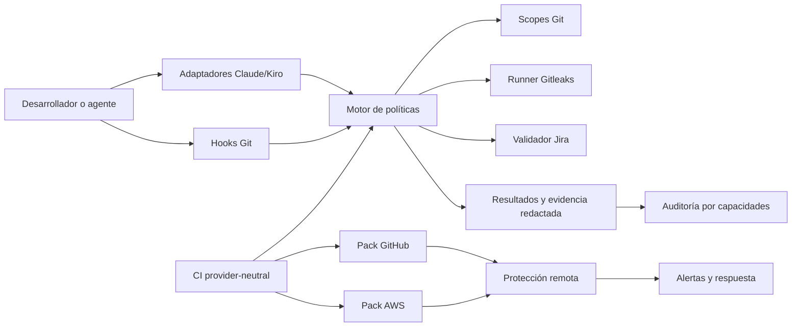
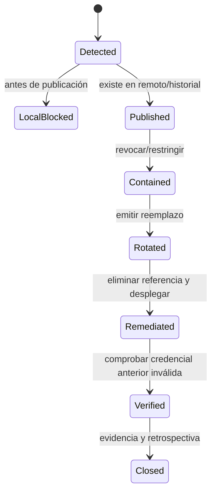
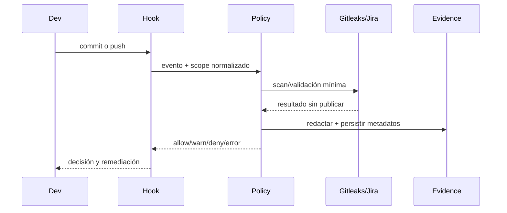
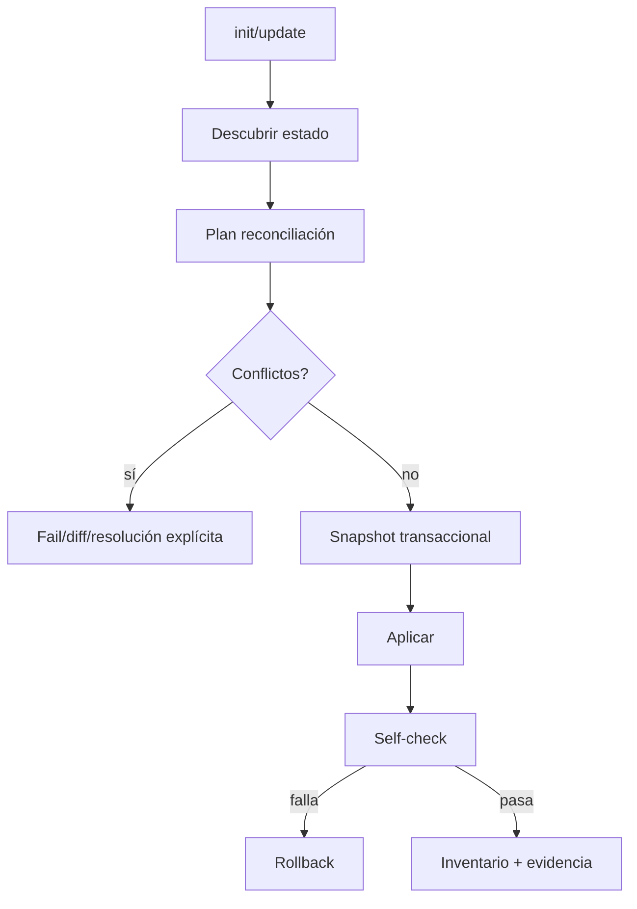

# Diseño técnico — Seguridad integral para `kiritek-init`

## 1. Objetivo y principios

Este diseño convierte `kiritek-init` de un instalador de convenciones en un sistema de controles ejecutables, auditables y portables. Se mantienen separados cuatro dominios: prevención local, protección remota de ramas, detección posterior al push y respuesta/rotación.

Principios:

1. **Un motor, varios adaptadores:** Git, Claude Code, Kiro y CI consumen la misma política y el mismo esquema de resultados.
2. **Seguro y explícito:** un error de herramienta nunca equivale a “sin hallazgos”.
3. **No destructivo:** instalación, actualización y desinstalación preservan personalizaciones y hooks preexistentes.
4. **Sin segunda filtración:** ningún resultado persiste el valor ni la línea completa de un secreto.
5. **Portable:** el core no depende de Flutter, Jira, GitHub ni AWS.
6. **Defensa en profundidad:** los controles cliente son evadibles; los controles remotos siguen siendo necesarios.
7. **Precisión del alcance:** IAM sobre la rama default protege esa rama, pero no impide que un secreto se publique en una feature branch.

## 2. Arquitectura y límites de confianza



### Límites

- **Workspace no confiable:** archivos, configuración del proyecto y argumentos Git pueden ser maliciosos. No se evalúan como shell.
- **Herramientas externas:** Gitleaks, Git, Jira y CLIs cloud se invocan con `spawn` y argumentos separados; nunca mediante concatenación.
- **CI de forks:** no recibe secretos de contextos privilegiados.
- **Resultados:** pasan obligatoriamente por redacción antes de stdout, JSON, artefactos o telemetría.
- **Cloud:** `kiritek-init` genera y valida planes; no aplica infraestructura sin confirmación explícita.

## 3. Estructura objetivo

```text
kiritek-init/
├── src/
│   ├── cli.js
│   ├── config/{load,validate,precedence}.js
│   ├── install/{inventory,reconcile,transaction,migrate,uninstall}.js
│   ├── domain/{result,evidence,policy,exception}.js
│   ├── policy/{engine,files,git,commits,exceptions}.js
│   ├── git/{default-branch,staged-scope,push-scope,hooks}.js
│   ├── scanners/{gitleaks-runner,tool-cache,redactor}.js
│   ├── integrations/{jira,claude,kiro,ci}.js
│   ├── audit/{capabilities,checks,report}.js
│   ├── incident/{classify,runbook}.js
│   └── providers/{github,codecommit}.js
├── templates/core/security/
│   ├── config/kiritek-security.config.json
│   ├── gitleaks/gitleaks.toml
│   ├── tools/manifest.json
│   ├── hooks/{pre-commit,pre-push,commit-msg}
│   ├── adapters/{claude,kiro}/
│   ├── ci/kiritek-security-ci.sh
│   ├── docs/{SECURITY,INCIDENT-RESPONSE,MIGRATION}.md
│   └── ignores/*.entries
├── templates/providers/{github,aws-codecommit}/
├── templates/stacks/flutter/.claude/skills/owasp-mobile-security-checker/
├── schemas/{config,result,evidence,audit,exception}.schema.json
└── test/{unit,integration,fixtures,smoke}/
```

Los templates contienen artefactos declarativos. La lógica vive en `src/`, evitando scripts divergentes por stack o proveedor.

## 4. Componentes

### 4.1 CLI y configuración

Se conserva CommonJS y Node.js >=18 inicialmente. El parser manual se reemplaza por un parser interno tipado, sin añadir una dependencia hasta evaluar supply chain.

Comandos:

```text
kiritek-init init [--security=warning|enforce|off] [--assistant=claude,kiro]
kiritek-init update [--dry-run] [--conflict=fail|keep|prompt]
kiritek-init scan --scope=staged|push|repository|history [--json]
kiritek-init validate commit|push|config
kiritek-init audit [--deep] [--json]
kiritek-init security doctor
kiritek-init security promote --to=enforce
kiritek-init security exception validate
kiritek-init provider plan github|aws-codecommit
kiritek-init uninstall --security
```

Precedencia, de mayor a menor: flags > variables `KIRITEK_*` > configuración del repo > defaults versionados. Valores desconocidos fallan. Credenciales nunca se aceptan por flag ni se serializan.

Configuración resumida:

```json
{
  "$schema": "./schemas/config.schema.json",
  "version": 1,
  "mode": "warning",
  "defaultBranch": { "explicit": null, "remote": "origin" },
  "secrets": { "gitleaksVersion": "<exact>", "historyDepth": "full" },
  "git": { "blockDirectDefaultPush": true, "forcePolicy": "deny" },
  "jira": { "enabled": false, "keyPattern": "[A-Z][A-Z0-9]+-[0-9]+", "unavailable": "fail-closed" },
  "evidence": { "maxAgeHours": 24, "directory": ".kiritek/security" },
  "telemetry": { "enabled": false }
}
```

### 4.2 Inventario y reconciliador transaccional

Cada artefacto administrado se registra con ruta, versión, hash de distribución, hash instalado, estrategia (`owned`, `managed-block`, `generated`, `user-owned`) y adaptador propietario. `update` deja de repetir `init`: calcula estado deseado y produce operaciones.

```text
FUNCTION reconcile(current, desired, mode):
  plan = diffInventory(current, desired)
  FOR operation IN plan:
    IF user-owned content would be overwritten:
      mark conflict; require configured resolution
    IF mode == dry-run:
      continue
  snapshot affected files and git config
  TRY:
    apply operations atomically using temp files + rename
    run post-install self-checks
    write inventory only after all checks pass
  CATCH error:
    restore snapshot and git config
    return rollback evidence and nonzero exit
```

Entradas de ignores y plantillas existentes se gestionan mediante bloques marcados. Si un archivo no admite composición segura, se genera `.kiritek-new`/diff y se falla en modo no interactivo.

### 4.3 Motor de políticas

Entrada normalizada:

```text
PolicyInput = {
  event, mode, repositoryRoot, actorType,
  command?, paths?, gitUpdates?, scope?, configHash
}
```

Salida:

```text
PolicyResult = {
  schemaVersion, decision: allow|warn|deny|error,
  controlId, severity, scope, findings[], remediation,
  evidenceRef?, toolStatus, timestamp
}
```

El motor es puro cuando sea posible. Runners y adaptadores recolectan datos; las políticas deciden. `error` nunca se transforma en `allow` en enforcement salvo fallback explícito del control.

### 4.4 Gitleaks y distribución

`tools/manifest.json` fija versión exacta, URL permitida y SHA-256 por OS/arquitectura. El cache se ubica fuera del repo o en un directorio ignorado. Se admite binario del sistema sólo si cumple la versión configurada.

```text
FUNCTION resolveGitleaks(platform, arch, offline):
  expected = manifest.lookup(platform, arch)
  IF compatible system binary exists AND version == expected.version:
    return verified system binary
  IF cached binary checksum == expected.sha256:
    return cached binary
  IF offline: return TOOL_UNAVAILABLE
  download to temporary path from allowlisted HTTPS URL
  verify sha256 and reported version
  atomically move to cache; return binary
```

Gitleaks genera salida temporal restringida. El parser conserva regla, fingerprint, ruta relativa y línea numérica; descarta secreto, match y línea fuente antes de persistir.

### 4.5 Alcances Git

**Staged:** se crea un índice temporal o se usa la modalidad `protect --staged` compatible con la versión fijada. El análisis nunca mezcla contenido unstaged.

**Pre-push:** Git entrega por stdin líneas `<local-ref> <local-sha> <remote-ref> <remote-sha>`. Cada actualización se clasifica como creación, actualización, borrado o tag.

```text
FUNCTION computePushScopes(stdinLines):
  scopes = []
  FOR update IN parseStrictly(stdinLines):
    IF update.localSha is zero: scopes += DELETE_REF(update); CONTINUE
    enforceRefPolicy(update)
    IF update.remoteSha is not zero:
      commits = revList(update.remoteSha + ".." + update.localSha)
    ELSE:
      base = mergeBaseWithVerifiedRemoteDefault(update.localSha)
      commits = base ? revList(base + ".." + update.localSha)
                     : revListAllReachableNewObjects(update.localSha, advertisedRemoteRefs)
    scopes += immutable commit set with reason
  return deduplicate(scopes)
```

Un rango ambiguo amplía el escaneo o falla; nunca reduce cobertura silenciosamente. Pushes múltiples evalúan cada ref. `+refspec`, `--force`, `-f` y non-fast-forward se deniegan según política. `--force-with-lease` no es automáticamente permitido.

### 4.6 Rama default

Precedencia: configuración explícita > `refs/remotes/<remote>/HEAD` > API autenticada del proveedor > upstream verificable. Si hay discrepancia, enforcement exige configuración explícita.

```text
FUNCTION resolveDefaultBranch(repo, remote):
  candidates = collectConfiguredSymbolicProviderAndUpstreamValues()
  IF explicit exists: verify format; return explicit
  IF trusted candidates agree: cache with source and timestamp; return value
  IF candidates conflict OR none: return AMBIGUOUS
```

La auditoría compara el valor cacheado/configurado con el remoto y reporta drift.

### 4.7 Hooks Git componibles

Se prefieren scripts versionados en `.kiritek/hooks/` y un dispatcher. Estrategias:

1. Integrarse al gestor detectado (Lefthook, Husky, pre-commit, CaptainHook).
2. Si existe `core.hooksPath`, instalar un shim administrado sólo si puede encadenar lo anterior.
3. Si existen hooks nativos sin estrategia segura, generar plan manual y no sobrescribir.

Cada shim evita recursión con una variable interna, preserva stdin/argv/exit code y ejecuta Kiritek y el hook previo conforme a una política documentada. La desinstalación retira sólo el bloque o shim Kiritek y restaura configuración registrada.

### 4.8 Adaptadores Claude Code y Kiro

Los adaptadores sólo traducen eventos a `PolicyInput` y convierten `deny` al mecanismo de bloqueo soportado. No duplican patrones sensibles.

- **Claude Code:** hooks `PreToolUse` repo-scoped en `.claude/`; decisión por JSON (`hookSpecificOutput.permissionDecision`) con exit 2 como bloqueo duro de respaldo (ver 4.8.2).
- **Kiro:** hooks por workspace en `.kiro/hooks/*.json` (formato `"version": "v1"`), activados al iniciar sesión. El bloqueo se logra con un hook `PreToolUse` cuya acción `command` invoca el CLI core; la decisión se expresa por **exit code**, no por un esquema `permissionDecision` (ver 4.8.1).
- Si una versión no permite interceptar una operación, auditoría marca `unavailable`; Git/CI siguen cubriendo el control.

#### 4.8.1 Contrato confirmado del adaptador Kiro

Verificado contra la documentación oficial de Kiro (kiro.dev/docs/hooks). Diferencias clave respecto de Claude Code:

- **Bloqueo real por exit code.** `PreToolUse` con acción `command` que termina en **exit 2 bloquea** la tool y devuelve `stderr` al agente; **exit 0 permite**; cualquier otro código se trata como fallo del hook y la tool **continúa**. Por tanto el CLI core debe mapear `deny → exit 2`, `allow/warn → exit 0`, y nunca usar códigos arbitrarios para denegar.
- **No existe modo `ask` para `PreToolUse`.** El patrón `hookSpecificOutput.permissionDecision` con `ask/deny/allow` es de Claude Code y **no aplica** a Kiro; el único mecanismo de decisión por stdout documentado (`decision: block`) es del trigger `Stop`. El adaptador Kiro no debe depender de confirmación interactiva en `PreToolUse`.
- **Payload por stdin.** El hook recibe JSON con `hook_event_name`, `cwd`, `session_id`, `tool_name` y `tool_input` (`tool_response` sólo en `PostToolUse`). El adaptador normaliza estos campos a `PolicyInput` y no asume claves no documentadas dentro de `tool_input`; valida de forma defensiva y, ante formato inesperado, usa el fallback seguro del modo activo.
- **Matcher por nombre de tool (regex).** Escritura: `fs_write` (alias `write`) y `str_replace`; ejecución/comandos Git: `execute_bash` (alias `shell`); AWS: `use_aws`. El adaptador registra hooks para estas tools de escritura y de comandos. Como el catálogo de tools no es cerrado, se prefiere incluir las conocidas y degradar a `unavailable` lo no interceptable, en lugar de asumir cobertura total.
- **Degradación honesta.** `--no-verify` y el push peligroso se bloquean sólo si pasan por una tool de comando interceptada; la auditoría declara explícitamente que un comando ejecutado fuera del alcance del hook no queda cubierto por esta capa y depende de los hooks Git y CI.

#### 4.8.2 Contrato confirmado del adaptador Claude Code

Verificado contra la documentación oficial de Anthropic (docs.claude.com/en/docs/claude-code/hooks). Claude Code ofrece un control más rico que Kiro; el adaptador debe aprovecharlo sin asumir que Kiro es equivalente:

- **Decisión por JSON en stdout.** `PreToolUse` devuelve `hookSpecificOutput.permissionDecision` con cuatro valores: `allow`, `deny`, `ask` (pide confirmación al usuario) y `defer`. El motor core mapea `deny → deny` con `permissionDecisionReason` redactado (se muestra a Claude), y puede usar `ask` para operaciones de riesgo medio donde se prefiera confirmación humana en lugar de bloqueo duro.
- **Exit 2 como fail-safe.** Independiente del JSON, exit 2 bloquea la tool y ni un `permissionDecision: "allow"` lo revierte. El adaptador usa exit 2 cuando el propio hook falla o no puede emitir JSON válido, de modo que un error se comporte como bloqueo y no como permiso.
- **Precedencia multi-hook.** Si coexisten varios `PreToolUse`, la precedencia es `deny > defer > ask > allow`; el adaptador no debe asumir que es el único hook ni intentar "permitir por encima" de una regla deny.
- **Payload por stdin.** Incluye `session_id`, `cwd`, `hook_event_name`, `tool_name`, `tool_input` y `tool_use_id`. Las rutas de file-tools llegan absolutas con separadores nativos (backslash en Windows); el adaptador normaliza esto antes de evaluar políticas.
- **Matcher por nombre de tool.** `Edit|Write` para escritura, `Bash` para comandos; MCP vía `mcp__.*`. El adaptador registra las tools de escritura y comando relevantes.
- **Diferencia clave con Kiro.** Claude dispone de `ask`/`defer` y `updatedInput`; Kiro no. La política central es única, pero cada adaptador traduce la misma decisión al mecanismo disponible: en Claude puede degradar a `ask`; en Kiro una decisión no-`deny` siempre resuelve a exit 0 (permitir), porque no existe confirmación intermedia.

Archivos sensibles se clasifican por ruta y contenido. `.env.example` sólo pasa si Gitleaks y el validador de placeholders lo consideran seguro. Los errores muestran ruta/categoría/remediación, nunca valores.

### 4.9 Commits y Jira

`commit-msg` valida Conventional Commits y sintaxis de la clave sin red. `pre-push` y CI extraen claves de commits/rama/metadata PR y consultan Jira con credenciales de sólo lectura, timeout, rate limit y cache por tenant.

Estados: `verified`, `invalid`, `unavailable`, `not_configured`. En warning, indisponibilidad produce `warn/unverified`; en enforcement el default es fail-closed. Una respuesta “no existe” siempre deniega. `NO-JIRA` sólo existe como excepción gobernada.

### 4.10 Evidencia, redacción y excepciones

`Evidence` contiene commit, control, versión de herramienta, hash de config, alcance, timestamps, exit code, decisión y referencia al reporte redactado. No contiene código ni prompts.

Toda salida cruza `redactor`, que aplica eliminación por campos, sanitización de URLs/headers y un detector final de patrones. Si la validación de redacción falla, el reporte no se publica.

Las excepciones son documentos schema-valid con `controlId`, fingerprint/ruta mínima, razón, owner, ticket, aprobador, creación y expiración. Firmas/owners remotos protegen cambios. Expiración o cambio de fingerprint reactiva el hallazgo. `--no-verify` nunca es excepción.

### 4.11 Auditoría por capacidades

Cada check devuelve estados independientes:

```text
Capability = {
  id, applicable,
  installed, version, integrity, configured,
  active, executable, enforcement, lastRun,
  lastResult, drift, evidenceRef, reason
}
```

Checks profundos usan secretos sintéticos reservados para demostrar bloqueo y redacción. CI/proveedor remoto distingue `observed`, `unauthorized`, `not-configured`, `not-applicable` y `unknown`. Conventional Commit rate permanece como métrica de adopción, no de seguridad.

### 4.12 Flutter

Gitleaks core reemplaza el rol genérico de `scan_hardcoded_secrets.py`. El pack Flutter conserva análisis OWASP móvil de red, almacenamiento y dependencias. Todos los scanners implementan un adaptador al esquema común y pasan por redacción. La heurística de versiones no se denomina CVE sin una fuente real de advisories.

### 4.13 CI provider-neutral

`kiritek-init scan/validate/audit --json --non-interactive` constituyen la interfaz portable. Adaptadores CI sólo calculan contexto y publican el resultado. El workflow semanal deja de commitear a default: sube artefactos redactados o abre un PR sujeto a checks.

Controles mínimos: checkout suficiente, permisos de sólo lectura por defecto, timeout, concurrency, acciones fijadas por SHA, separación de eventos de fork y ausencia de secretos privilegiados al ejecutar código no confiable.

### 4.14 Pack GitHub

Genera plan para rulesets (preferido) o branch protection: PR obligatorio, reviews, conversaciones resueltas, checks requeridos, sin force/borrado y CODEOWNERS para políticas. Actions invoca el CLI core. Secret scanning/push protection se observa/habilita sólo si plan y permisos lo permiten; nunca reemplaza Gitleaks. Aplicación remota requiere confirmación.

### 4.15 Pack AWS CodeCommit

Genera IaC/planes para IAM mínimo privilegio sobre la rama default, approval rule templates, CodeBuild/CodePipeline, aprobación manual de producción, SNS/EventBridge y runbooks. Los stages ejecutan el CLI core y almacenan sólo resultados redactados. La documentación repite que IAM sobre default no evita que un secreto llegue por una feature branch. La aplicación es dry-run por defecto y requiere confirmación y rollback.

### 4.16 Incidentes y rotación



La severidad considera proveedor, privilegios, exposición y entorno. Un secreto publicado exige revocación/rotación aunque se borre del archivo. Reescritura de historial es opcional, coordinada y nunca sustituye rotación.

### 4.17 Rollout y break-glass

Instalaciones nuevas empiezan en `warning`, salvo política organizacional explícita. `security doctor` exige herramienta íntegra, hooks activos, CI configurado, Jira disponible cuando aplica, cero secretos nuevos y excepciones válidas antes de promover. Hallazgos críticos pueden bloquear incluso en warning mediante configuración explícita.

Break-glass es un flujo separado: identidad autorizada, ticket/incidente, alcance, expiración y revisión posterior. No desactiva permanentemente controles ni usa `--no-verify`.

### 4.18 Supply chain y plataformas

- Versiones exactas y checksums para binarios; Actions fijadas por SHA.
- Nada de `curl | sh`, ramas Git mutables ni instalaciones globales silenciosas.
- SBOM opcional del CLI y herramientas distribuidas.
- Matriz: macOS/Linux soportados; Windows mediante Node y scripts sin dependencia de Bash donde sea viable. Capacidades no portables se declaran.
- Rutas con espacios, worktrees, proxy, CA corporativa, cache y offline son escenarios de primera clase.

### 4.19 Observabilidad y privacidad

Telemetría opt-in, autenticada, minimizada e idempotente. Sólo envía IDs de control, estado, duración, versión y plataforma general. Nunca repo URL completa, código, prompts, rutas absolutas, tickets privados o matches. Alertas agregan fallos de herramienta, excepciones expiradas y bypasses sin contenido sensible.

## 5. Flujos principales





## 6. Manejo de errores

Exit codes estables: `0 allow/clean`, `1 policy deny/findings`, `2 configuration`, `3 tool unavailable/integrity`, `4 internal`, `5 remote unavailable`, `6 migration conflict`. En warning, findings pueden devolver 0 sólo si JSON conserva `warn`; errores de integridad no se ocultan. Mensajes incluyen causa, alcance y remediación.

## 7. Estrategia de pruebas

- **Unitarias:** parser/config, redactor, política, default branch, refspecs, excepciones y schemas.
- **Integración Git:** repos temporales con staged/unstaged, ramas nuevas, múltiples refs, tags, deletes, force, worktrees, hooks existentes y rutas con espacios.
- **Herramientas:** binario/checksum/version mismatch, cache/offline/proxy y reportes maliciosos.
- **Adaptadores:** payloads Claude/Kiro válidos e inválidos, compatibilidad y decisiones deny.
- **Jira:** mock server para 200/404/401/429/timeout, tenants y cache.
- **Migración:** fixture 0.1.0 con personalizaciones; dry-run, rollback y desinstalación.
- **Providers:** validación estática de IAM/workflows/IaC y snapshots de planes; sin aplicar cloud.
- **Privacidad:** canarios sintéticos que deben bloquearse y no aparecer en ninguna salida.
- **Matriz smoke:** Node soportado en macOS, Linux y Windows donde aplique.

Pruebas de propiedad/fuzzing cubren parsing de stdin de pre-push, rutas, refspecs y redacción. Los fixtures usan credenciales no funcionales reservadas.

## 8. Migración y despliegue

1. Publicar schemas, motor y reconciliador sin enforcement.
2. Migrar proyectos 0.1.0 a inventario; detectar, no sobrescribir.
3. Instalar core en warning y ejecutar `doctor`.
4. Corregir el workflow semanal mediante plan/diff; nunca push directo.
5. Activar CI y recolectar métricas mínimas durante 2–3 semanas.
6. Resolver hallazgos, conflictos y excepciones.
7. Promover por repositorio/equipo a enforcement.
8. Instalar packs de proveedor sólo donde correspondan.

Rollback restaura snapshot e inventario previo. Downgrade sólo se permite si schemas y políticas son compatibles.

## 9. Decisiones y alternativas rechazadas

- **Gitleaks como baseline:** se prefiere a extender regex Flutter por cobertura, mantenimiento y formatos; el scanner móvil permanece especializado.
- **Hooks versionados + dispatcher:** se rechaza escribir directamente `.git/hooks` sin composición porque no viaja y destruye integraciones.
- **Motor compartido:** se rechazan políticas duplicadas en YAML de cada CI/asistente por drift.
- **Warning inicial:** se rechaza enforcement abrupto en repos existentes.
- **No detectores de autoría IA:** no prueban veracidad y generan falsos positivos; se exige evidencia verificable.
- **No autoaplicar cloud:** los cambios IAM/rulesets son de impacto alto y requieren plan y confirmación.
- **No confiar sólo en IAM default:** no protege feature branches contra secretos.
- **No persistir líneas completas:** se sacrifica contexto en favor de evitar una segunda exposición.

## 10. Trazabilidad

| Requisitos | Componentes de diseño |
|---|---|
| 1–2 | Core, CLI/config, reconciliador, distribución Gitleaks |
| 3–4 | Scopes Git, runner, hooks componibles |
| 5–8 | Motor de políticas, adaptadores, guardas Git, rama default |
| 9–11 | Commit validator, Jira, evidencia |
| 12–13 | Adaptador Flutter, redactor, reportes e ignores |
| 14–15 | Auditoría por capacidades, CLI CI, workflow seguro |
| 16 | Pack AWS CodeCommit |
| 17 | Pack GitHub |
| 18 | Templates y evidencia de estados |
| 19 | Incidentes y rotación |
| 20–21 | Rollout, reconciliación, migración y rollback |
| 22–23 | CLI/config y compatibilidad de plataforma |
| 24–25 | Supply chain, telemetría y privacidad |
| 26 | Estrategia de pruebas y evidencias |
| 27 | Documentación, runbooks y migración |
| 28 | Modelo y gobernanza de excepciones |

## 11. Criterio de diseño terminado

El diseño se considera implementado cuando los criterios globales G.1–G.15 de `requirements.md` cuentan con pruebas automatizadas o evidencia manual definida; la auditoría distingue presencia de funcionamiento; ningún canario secreto aparece en salidas; y core, GitHub y AWS pueden instalarse y validarse de manera independiente.